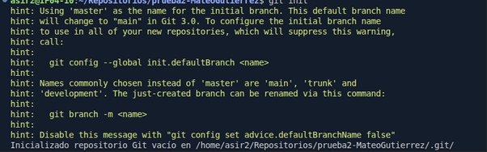
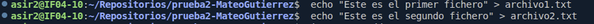
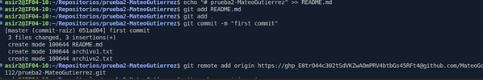
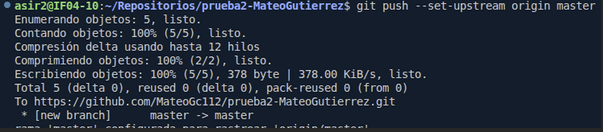

# Ejercicio1 / Introducción a git y GitHub
### Mateo Gutiérrez Cabo

**Apartado 14** /  
1. Procedemos con el Git Init  
  

2. Creación de los ficheros en prueba2
  

3. Todos los git add, git commit. Además, el git remote add con mi token  

4. Git push haciendo que mi rama master sea el origen y con upstream puedo subir el push. 
