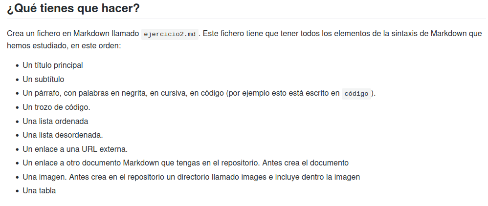

# Ejercicio2  <!-- Titulo -->
### Mateo Gutiérrez Cabo <!-- Subtítulo -->

*Este ṕarrafo* **contiene todo tipo de variantes** 
``` 
Esta por ejemplo es la de "código"
echo "hola mundo"
mkdir Repositorios
clear
```  
<!-- Este apartado es de listas -->
* item1  
* item2
* item3
* item4
1. elemento 1
2. elemento 2
3. elemento 3  
I. 1  
II. 2  
III.3  

<!-- URL -->

[Página de Luis] (https://lgarciavelazquez.github.io/iaw_202627/unidad1/ejercicio2.html)  

[Otro Markdown] (https://github.com/MateoGc112/prueba_MateoGutierrez/blob/main/ejercicio1.md)

<!-- Imágen -->



<!-- Tabla -->

| Encabezado1 | Encabezado2 |
| --- | --- |
|fila1.1 |fila1.2 |
|dila2.1 |fila2.2 |