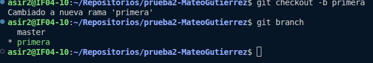
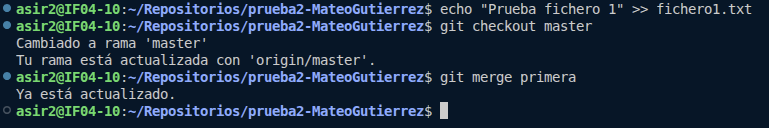
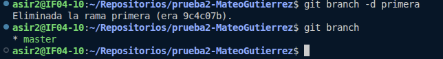
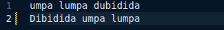
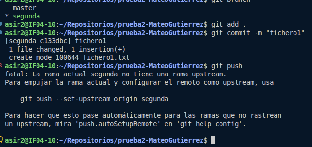
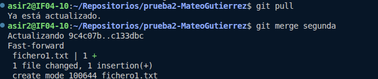
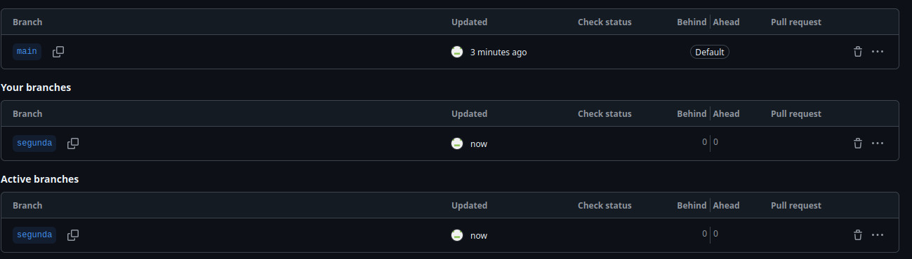

# Ejercicio 3
### Mateo Gutiérrez Cabo


- El primer paso es crear la rama "Primera". Que será con la que trabajaremos al principio.
  

- Creamos el fichero uno en la rama primera. Seguido, cambiamos a la rama "master". Ponemos el comando:  
``` 
git checkout master
git merge primera
```


- Ahora, hemos de eliminar la rama primera. Una vez ejecutado el comando **git branch -d primera**, miramos las rama que tenemos.



- Creamos la rama "segunda" y nos posicionamos en ella. He modificado en esta rama el fichero1.  


- He dejado el commit hecho  



- Para este paso. Lo primero es cambiar a tu rama **master** y hacer un pull. Ahora que master está actualizado (Aunque lo esté, siempre viene bien hacer un pull antes de empezar) hay que hacer el merge de **segunda** si el merge es exitoso sale (en este caso) ``` fichero.txt 1 + | 1 file changed ``` Con lo cual se han juntado y actualizado, ahora master y segunda se encuentran a la par.


